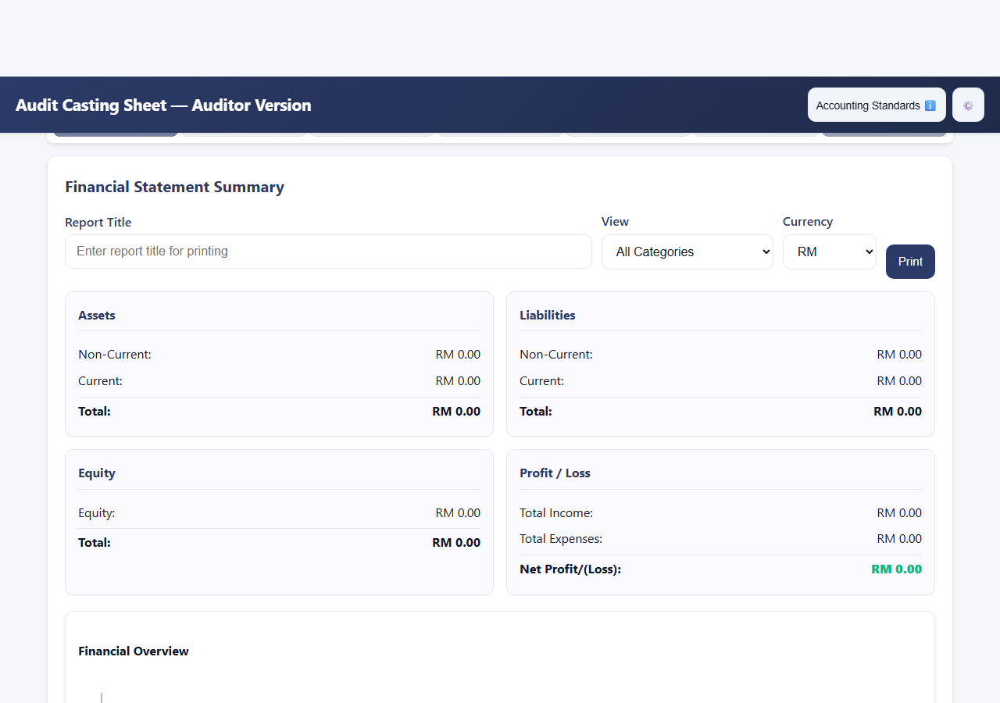
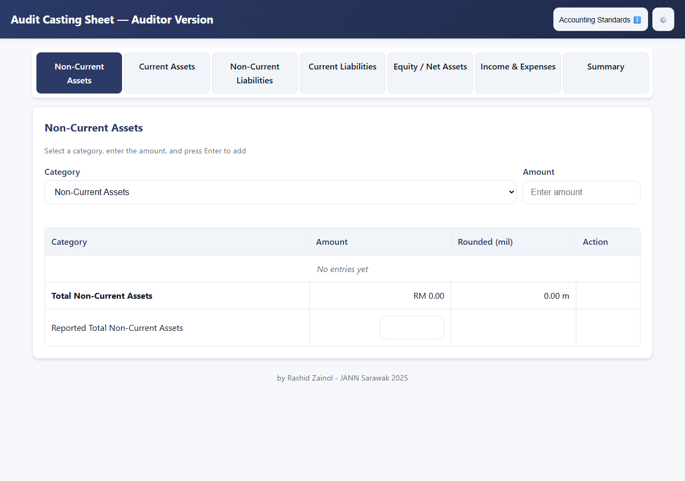
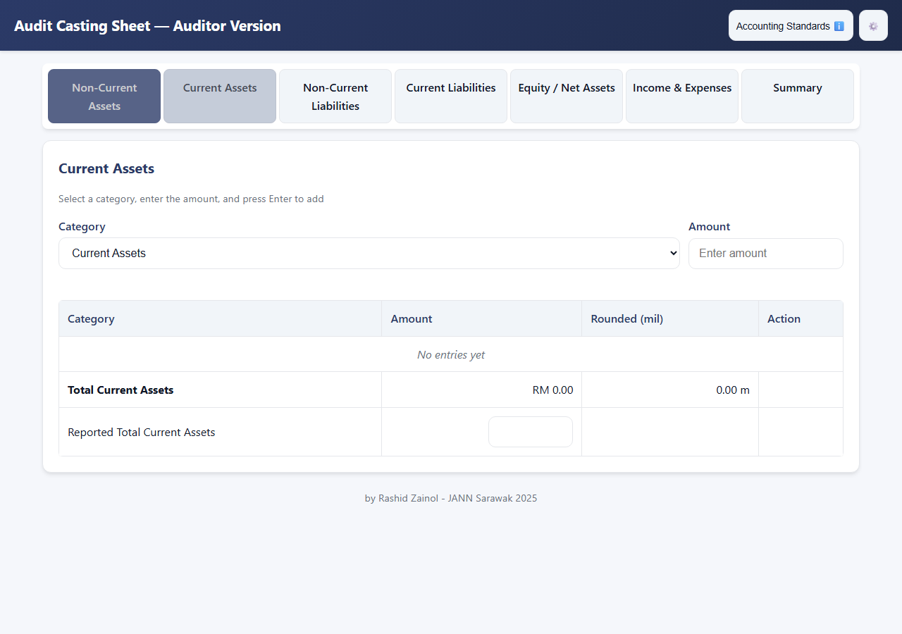
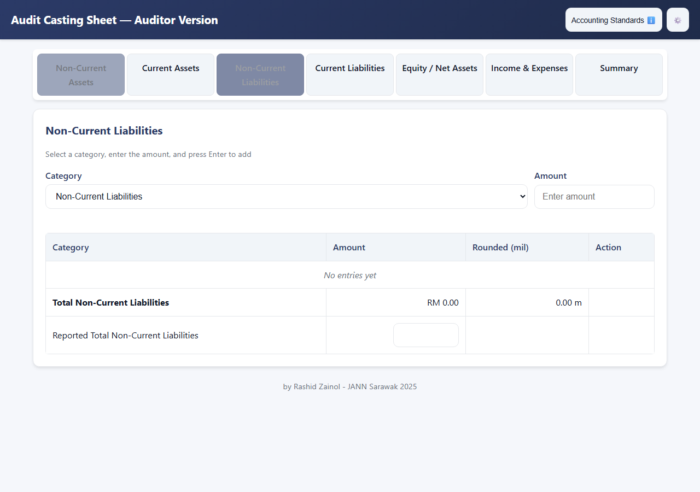
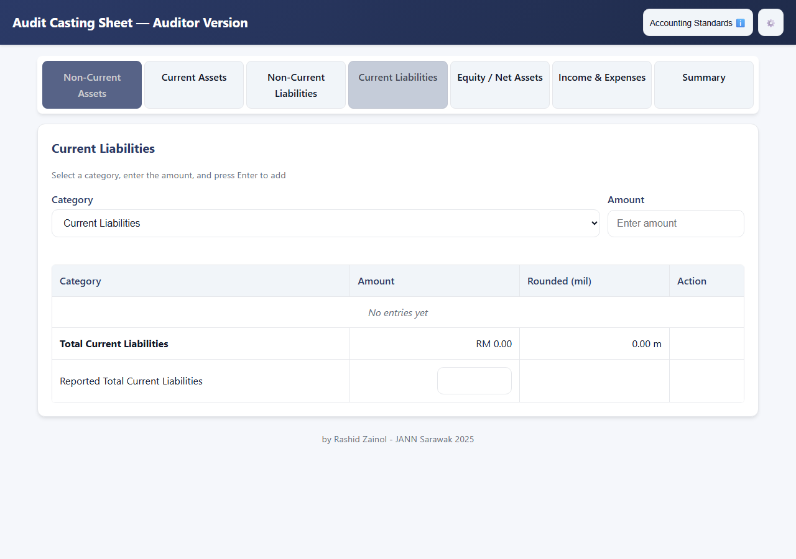
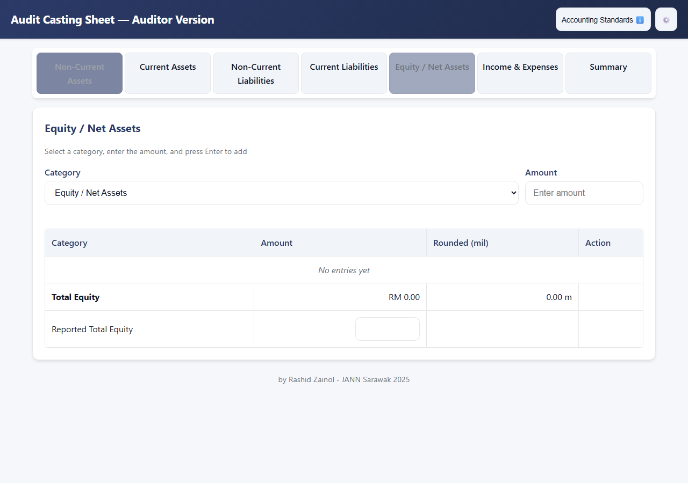
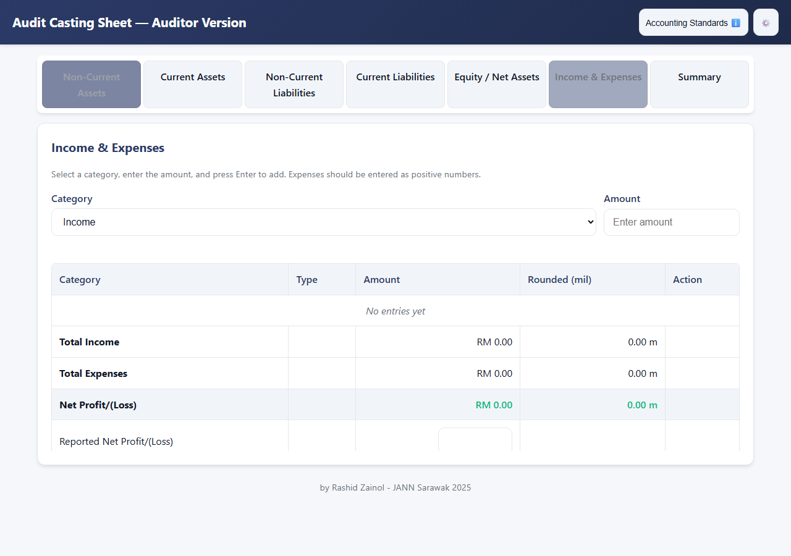
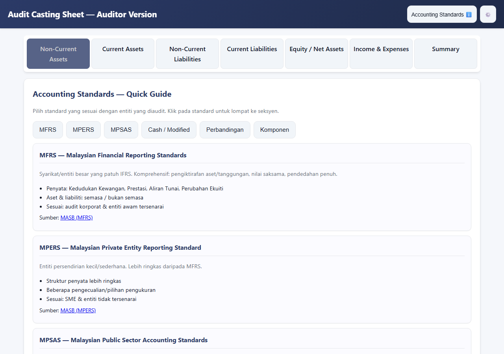

# Audit Casting Sheet — Auditor Version

A browser-based financial statement casting and reconciliation tool for auditors. Verify totals, cross-check reported figures, and produce professional summaries — entirely offline, with no installation required.

## ✨ Key Features

- **Multi-category casting**: Non-current/current assets, liabilities, equity, income & expenses.
- **Automatic validation**: Real-time casting checks against reported figures with configurable tolerance.
- **Financial ratios**: Current ratio, debt-to-asset ratio, net asset ratio.
- **Multiple reporting standards**: MFRS, MPERS, MPSAS, Cash / Modified Cash (terminology & categories adapt).
- **Data management**: Auto-save to browser storage, JSON export/import, CSV export/import.
- **Themes**: Professional, Calm, Happy, Dark — with good contrast.
- **Bilingual UI**: English (ENG) and Bahasa Malaysia (MY).
- **Print-ready**: Professional report printing.
- **Offline-capable**: No server, no dependencies, all data stays on your device.

## 📸 Screenshots

### Non-Current Assets

### Current Assets

### Non-Current Liabilities

### Current Liabilities

### Equity / Net Assets

### Income & Expenses

### Accounting Standards Guide

### Summary & Metrics

## 🚀 Quick Start

1. Download `Audit Casting Sheet.html` (or the release ZIP).
2. Open it in any modern browser (Chrome, Edge, Firefox, Safari).
3. Select a reporting standard, enter figures, and start casting.

No build step, no server, no account.

## 📊 Usage

- **Adding entries**: Select a category, enter the amount, press Enter.
- **Editing**: Click **Edit** on a row, update the amount.
- **Deleting**: Click **Del** and confirm.
- **Reconciliation**: Enter reported totals in the "Reported" fields; status shows ✓ Match or ✗ Mismatch with difference.
- **Casting check**: In Summary, enter Reported Total Assets and click **Check Casting**.
- **Save/Load**: Use ⚙️ Settings → 💾 Save Session / 📂 Load Session (JSON).
- **Export/Import CSV**: Use 📤 / 📥 for spreadsheet compatibility.
- **Print**: Use 🖨️ for a professional report.

## 📐 Supported Reporting Standards

| Standard | Sector | Basis | Complexity |
|---|---|---|---|
| MFRS | Corporate (public) | Full accrual | High |
| MPERS | Private entities | Full accrual | Medium |
| MPSAS | Public sector | Full accrual | High |
| Cash / Modified Cash | Small entities, clubs | Cash / modified | Low |

Terminology and available components adapt when you switch standards. See the **Accounting Standards** panel for a detailed guide and component comparison.

## 💾 Data & Privacy

- All data is stored in your browser (localStorage) and can be exported as JSON/CSV.
- Nothing is sent to any server. Your financial data stays on your device.
- Recommended: export JSON backups regularly.

## 🛠️ Tech Stack

- Pure HTML, CSS, and JavaScript (single file).
- No external dependencies, no build tools.
- Offline-first; works on desktop, tablet, and mobile.

## 📚 References

- Malaysian Accounting Standards Board (MASB) — MFRS & MPERS: https://www.masb.org.my
- Jabatan Akauntan Negara Malaysia (JANM) — MPSAS: https://www.anm.gov.my
- Malaysian Institute of Accountants (MIA): https://www.mia.org.my
- IPSAS (International Public Sector Accounting Standards): https://www.ipsasb.org
- IFRS Foundation: https://www.ifrs.org

## 📦 Release

Download the latest release ZIP from the **Releases** page. It contains:
- `Audit Casting Sheet.html` — the application
- `screenshots/` — preview images
- `README.md` — this document

## 📄 License

This project is open source and available under the MIT License.

---

**Note**: This is a client-side tool. Always verify results against original source documents for critical audit work.